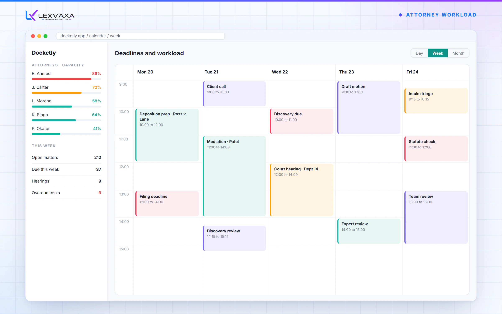

<!-- styled:v2 -->

**A workload dashboard that shows capacity per attorney alongside hearings, filings and statute deadlines on one shared calendar.**

  
  
  
  
  
  
  
  

  <a href="#overview">Overview</a> ·
  <a href="#key-features">Key features</a> ·
  <a href="#results">Results</a> ·
  <a href="#tech-stack">Tech stack</a>

---

## Overview

Deadlines and caseloads were spread across calendars and the case system, which made it hard to balance work. Lexvaxa built Docketly, a custom dashboard that pulls matters and tasks from the case management system and Google Calendar. It shows open matters, weekly due dates and overdue tasks, caseload and capacity per attorney, matters by stage and a week calendar of every hearing, filing and deadline. Screens shown use sample data, so no client records are exposed.

## The challenge

Without one view of deadlines and caseloads, some attorneys were overloaded while important dates were at risk.

## The solution

n8n syncs matters, tasks and calendar events into Supabase, and a React calendar shows deadlines next to each attorney's capacity.

## Key features

- Capacity and caseload per attorney
- Week calendar of hearings, filings and deadlines
- Open matters, due this week and overdue tasks
- Matters by stage
- Upcoming deadlines list

## Results

- Every deadline is visible and work is shared more evenly across the team

## Tech stack

      

## Demo

A working version of the dashboard UI with **sample data** is in [`demo/index.html`](demo/index.html). Download it and open it in a browser; it has no build step.

## Privacy

Client names and records are confidential. Every screen in this repository uses sample data, and source code that belongs to the client is not published.

## Links

- Case study on Lexvaxa: https://lexvaxa.com/work/attorney-workload-deadline-calendar

---

**Built by [Ch Muhammad Samiullah](https://github.com/samiullah156-creator)** · AI Automation Engineer and Full-Stack Developer at [Lexvaxa](https://lexvaxa.com)

⭐ Star this repo if you found it useful

